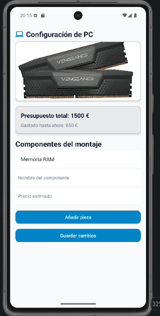
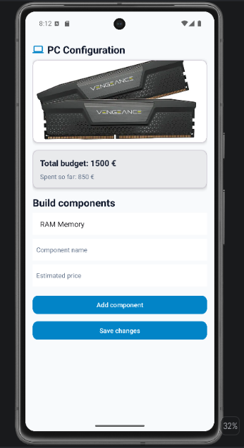
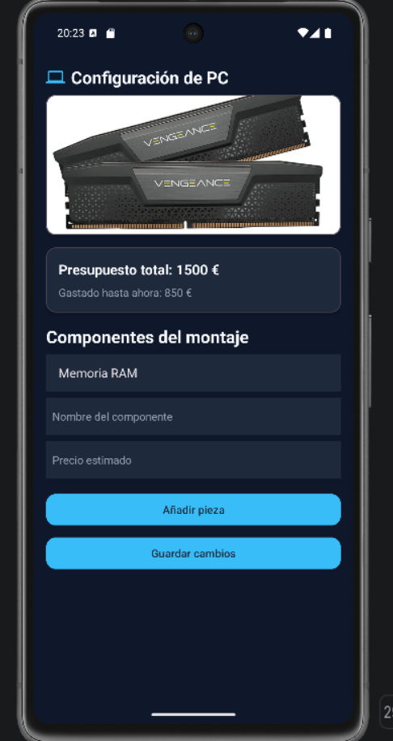

# PCbuilder - Asistente y Presupuesto de Hardware

**PCbuilder** es una aplicación móvil nativa desarrollada para la plataforma Android en el marco de la asignatura *Programación Multimedia y Dispositivos Móviles* (MEDAC).

La herramienta permite registrar componentes de hardware organizados por categorías, realizar el seguimiento de su estado de adquisición y calcular en tiempo real el coste presupuestario total del montaje, funcionando con total autonomía sin conexión a internet.

---

## Características técnicas y buenas prácticas

- **Desarrollo nativo:** Implementada en Java sobre arquitectura de vistas declarativas XML con SDK mínimo API 24 (Android 7.0 Nougat) y SDK objetivo API 35 (Android 15).
- **Cero Hardcoding (Separación de recursos):** Cumplimiento estricto de las directrices de Android. Todos los textos, dimensiones, colores y estilos residen en el directorio `res/` (`strings.xml`, `dimens.xml`, `colors.xml`, `themes.xml`), sin valores fijos en el código Java ni en los layouts XML.
- **Internacionalización completa (i18n):** Soporte bilingüe en **Español** (por defecto) e **Inglés** mediante calificador de recursos `values-en`, adaptando dinámicamente etiquetas, selectores desplegables (`Spinner`) y cadenas con parámetros numéricos (`%1$s`).
- **Tema Oscuro (Dark Mode):** Soporte dinámico para modo noche mediante `values-night/colors.xml`, manteniendo un alto contraste y accesibilidad visual.
- **Recursos gráficos y Branding:** Uso de iconos vectoriales escalables (*Vector Asset*), mapa de bits fotográfico optimizado e icono adaptativo propio (*Adaptive Icon*) configurado en `mipmap-*` y vinculado en el manifiesto.

---

## Estructura del repositorio

```text
PMDM_P1_DavidAlonso/
├── app/
│   ├── src/
│   │   └── main/
│   │       ├── java/es/medac/david/app/
│   │       │   └── MainActivity.java       # Lógica y control del ciclo de vida
│   │       ├── res/
│   │       │   ├── drawable/               # Vector Assets e imagen bitmap
│   │       │   ├── layout/
│   │       │   │   └── activity_main.xml   # Interfaz declarativa en ConstraintLayout/ScrollView
│   │       │   ├── mipmap-*/               # Icono adaptativo del lanzador
│   │       │   ├── values/
│   │       │   │   ├── colors.xml          # Paleta funcional en modo claro
│   │       │   │   ├── dimens.xml          # Dimensiones y márgenes estandarizados (dp/sp)
│   │       │   │   ├── strings.xml         # Recursos de texto en español (por defecto)
│   │       │   │   └── themes.xml          # Definición de temas y estilos
│   │       │   ├── values-en/
│   │       │   │   └── strings.xml         # Localización al inglés (i18n)
│   │       │   └── values-night/
│   │       │       └── colors.xml          # Paleta funcional para Modo Oscuro
│   │       └── AndroidManifest.xml         # Declaración de componentes y launcher
│   └── build.gradle.kts                    # Dependencias y SDK (minSdk 24, targetSdk 35)
├── docs/
│   ├── memoria.pdf                         # Memoria técnica completa de la práctica
│   └── screenshots/                        # Capturas de ejecución bilingüe y modo oscuro
├── .gitignore                              # Exclusión de carpetas generadas (build/, .gradle/)
├── build.gradle.kts                        # Configuración de compilación a nivel de proyecto
└── README.md                               # Guía principal del repositorio
```

---

## Capturas de pantalla

| Español (Por defecto) | Inglés (`values-en`) | Modo Oscuro (`values-night`) |
|:---:|:---:|:---:|
|  |  |  |

---

## Documentación del proyecto

La memoria técnica completa con el análisis teórico, especificación de requisitos, diagramas de ciclo de vida y justificaciones de diseño se encuentra disponible en:

📄 **[Consultar Memoria del Proyecto (PDF)](docs/memoria.pdf)**

### Contenido de la memoria:
1. **Parte A:** Análisis del desarrollo móvil, limitaciones de hardware (RAM, pantalla, batería, fragmentación), comparativa técnica y diagramas detallados del ciclo de vida de la Activity (general, llamada entrante, giro de pantalla y navegación atrás).
2. **Parte B:** Especificación de la app, objetivos medibles, requisitos funcionales (RF priorizados), requisitos no funcionales (RNF verificables), diagrama de casos de uso y fichas técnicas.
3. **Parte C:** Entorno de desarrollo, especificación técnica de los AVDs configurados (Pixel 7 y Pixel Tablet), capturas de ejecución y explicación de la estructura del proyecto.
4. **Parte D:** Justificación semántica de la paleta de colores, análisis técnico de formatos gráficos (vectorial vs mapa de bits), capturas bilingües y ampliación a tema oscuro.
5. **Conclusión:** Aprendizajes adquiridos y resolución de dificultades técnicas.

---

## Requisitos de compilación

- **IDE:** Android Studio (Ladybug / Meerkat o superior).
- **JDK:** Java 17 o superior.
- **Sistema de compilación:** Gradle con Kotlin DSL (`build.gradle.kts`).
- **Dispositivo de prueba:** Emulador o dispositivo físico con Android 7.0 (API 24) o superior.

---

## Instrucciones de ejecución

1. Clonar el repositorio:
   ```bash
   git clone [https://github.com/daa0010/PMDM_P1_DavidAlonso.git](https://github.com/daa0010/PMDM_P1_DavidAlonso.git)
   ```
   *(Sustituye `TU_USUARIO` por tu usuario de GitHub).*
2. Abrir **Android Studio** y seleccionar **Open**, eligiendo la carpeta raíz del proyecto clonado.
3. Esperar a que finalice la sincronización inicial de Gradle (*Sync Project with Gradle Files*).
4. Seleccionar un emulador virtual configurado (móvil o tablet) o un terminal físico.
5. Pulsar sobre el botón **Run 'app'** (`Shift + F10` o el botón de reproducir ▶).

---

## Autor

- **Alumno:** David Alonso Aguilar
- **Centro:** MEDAC
- **Titulación:** Desarrollo de Aplicaciones Multiplataforma (DAM)
- **Módulo:** Programación Multimedia y Dispositivos Móviles